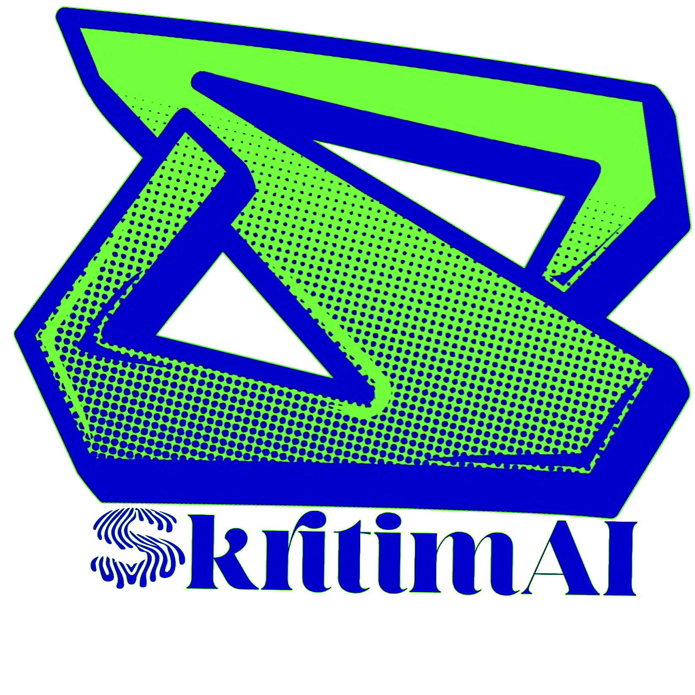
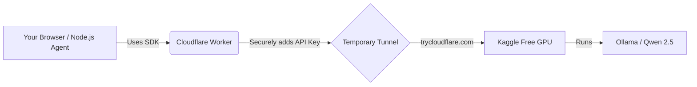

<div align="center">
  

  <h1>Skritimai AI Engine 🚀</h1>

  <p><strong>Your private, zero-cost, self-hosted AI backend running on free cloud GPUs.</strong></p>

  [](https://opensource.org/licenses/MIT)
  [](https://developer.mozilla.org/en-US/docs/Web/JavaScript)
  [](https://github.com/suryasticsai/skritimai)
  [](http://makeapullrequest.com)
</div>

---

## 🌟 What is Skritimai?

**Skritimai** (derived from *Kritima Medassu*, meaning Artificial Intelligence) is a fully functional, OpenAI-compatible AI engine. It bypasses expensive API bills by orchestrating an open-source LLM on **free Kaggle GPUs**, securely tunneling it to the web via **Cloudflare Workers**, and exposing a universal **JavaScript SDK**.

Whether you are building a web app, a CLI tool, or a GitHub Action agent, Skritimai provides a completely private, highly resilient, and 100% free inference engine.

---

## 🔥 Super Awesome Features

- 💸 **Zero Cost:** Runs on free Kaggle T4 GPUs and Cloudflare Workers. No API bills.
- 🔒 **100% Private:** Your prompts and data never touch OpenAI, Anthropic, or Google.
- ⚡ **Real-Time Streaming:** Built-in Server-Sent Events (SSE) parser for lightning-fast token generation.
- 🌐 **Universal SDK:** A single, zero-dependency `skritimai.js` file that works in Browsers, Node.js, and via CDN.
- 🧠 **Stateful Memory:** Includes a `Conversation` manager that automatically trims old messages to prevent context window crashes.
- 🔄 **Auto-Healing:** Automatically retries if the Kaggle tunnel goes to sleep (handles Cloudflare `502/503` errors with exponential backoff).
- 🎨 **Drop-in UI Widget:** Includes a beautifully styled `<skritimai-chat>` Web Component. Add a full AI chat to any website in 2 lines of code.
- 🛠️ **JSON Mode:** Built-in structured output parser, perfect for AI agents that need to return JSON.

---

## 🏗️ Architecture



---

## 🚀 Quick Start

You can use Skritimai right now using our ultra-fast jsDelivr CDN.

### Option 1: In the Browser (HTML/JS)

Drop a fully functional AI chat widget into your website:

```html
<!-- 1. Load the SDK -->
<script src="https://cdn.jsdelivr.net/gh/suryasticsai/skritimai@main/skritimai.js"></script>

<!-- 2. Drop the UI Component -->
<skritimai-chat
    base-url="https://YOUR-CLOUDFLARE-WORKER.workers.dev/v1"
    model="skritimai"
    system="You are a helpful assistant.">
</skritimai-chat>
```

### Option 2: In Node.js (For AI Agents / Bots)

If you are using Ariotica or building a backend agent:

```javascript
const Skritimai = require('./skritimai.js');

// Initialize the engine
Skritimai.init({
    baseUrl: "https://YOUR-CLOUDFLARE-WORKER.workers.dev/v1",
    apiKey: "not-needed", // The worker handles the real auth!
    model: "skritimai"
});

// Stream the response in real-time
async function run() {
    const convo = Skritimai.createConversation("You are a helpful AI.");

    await convo.send("Write a poem about JavaScript.", {
        stream: true,
        onChunk: (word) => process.stdout.write(word)
    });
}

run();
```

---

## 🛠️ How to Self-Host (The Magic Behind the Scenes)

Skritimai is designed to be deployed in under 10 minutes using entirely free tools:

1. **The Compute:** We use a custom `run_engine.py` script to boot Ollama on a Kaggle notebook with 2x T4 GPUs (32GB VRAM).
2. **The Tunnel:** Cloudflared exposes the local Kaggle port securely.
3. **The Gateway:** A Cloudflare Worker acts as a permanent URL and injects your secret API keys, protecting your GPU from abuse.
4. **The Sync:** A GitHub Action auto-updates the Cloudflare Worker with the new Kaggle tunnel URL every time it restarts.

(Check the `.github/workflows/` folder to see the orchestration pipeline!)

---

## 👨‍💻 Author

**Sai Surya Varakala**

Building autonomous AI systems and pushing the limits of what's possible on a zero-dollar budget.

<p align="left">
  <a href="https://github.com/suryasticsai">
    
  </a>
  <a href="https://www.linkedin.com/in/suryasticsai">
    
  </a>
  <a href="https://huggingface.co/Suryasticsai">
    
  </a>
</p>

---

<div align="center">
  <p>If this project saved you money, consider giving it a ⭐️!</p>
  <p>© 2026 Skritimai AI Engine. MIT Licensed.</p>
</div>
