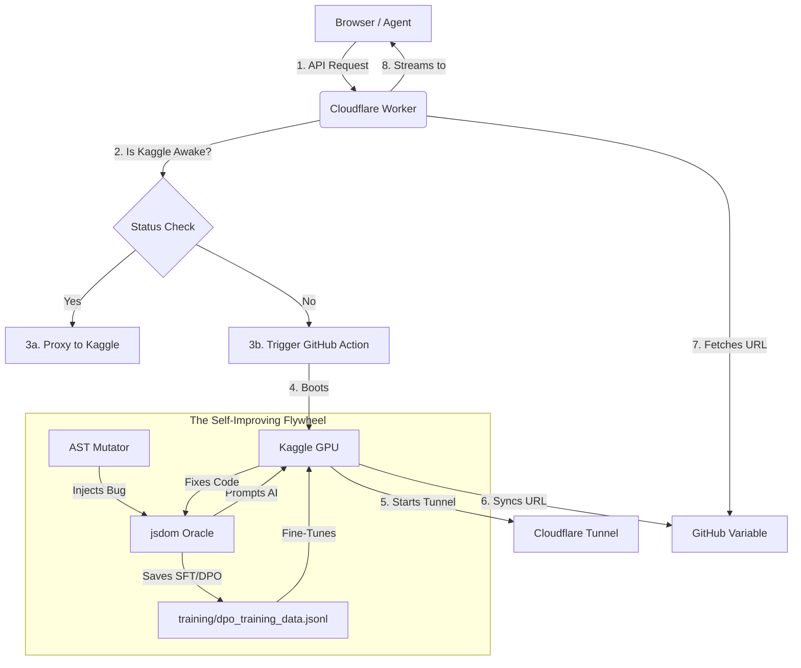

<div align="center">


# Skritimai AI Engine 🚀

**Your private, zero-cost, self-evolving AI backend running on free cloud GPUs.**

[](https://opensource.org/licenses/MIT)
[](https://developer.mozilla.org/en-US/docs/Web/JavaScript)
[](https://www.python.org/)
[](#)
[](#)
[](http://makeapullrequest.com)

</div>

---

## 🧠 What is Skritimai?

**Skritimai** (derived from *Kritima Medassu*, meaning Artificial Intelligence) isn't just another API wrapper. It is a **zero-dollar, enterprise-grade AI infrastructure** that turns free Kaggle GPUs into a fully autonomous, OpenAI-compatible inference engine.

We bypass expensive API bills, rate limits, and cloud hosting fees by orchestrating an open-source LLM (Qwen 2.5) on **free Kaggle GPUs**, securing it via **Cloudflare Workers**, and automating its lifecycle with **GitHub Actions**.

But we didn't stop there. We built a **Synthetic Data Flywheel**. Skritimai can now mutate its own codebase, catch its own bugs using an AST parser, ask its own LLM to fix them, and generate perfectly formatted fine-tuning datasets automatically.

**Welcome to the Micro-Singularity.**

---

## ⚡ The "Mad Scientist" Features

- 💸 **The $0 Enterprise Stack** — Runs on 32GB of free Kaggle VRAM. No API bills, no AWS bills. Ever.
- 🧬 **Self-Improving Data Flywheel (The Singularity Loop)**
  - Uses an **AST Mutator** (`mutate.js`) to inject realistic bugs into HTML/JS.
  - Uses a **jsdom Oracle** (`evaluate_code.js`) to verify if the code is broken.
  - Prompts your own Skritimai model to fix it.
  - Automatically outputs **DPO or SFT `.jsonl` training data** to your repo.
- 🚨 **Render-Style Wake-on-Demand**
  - Kaggle puts your GPU to sleep? The Cloudflare Worker automatically pings GitHub Actions, boots Kaggle, waits for the new tunnel URL, syncs it, and serves the user's request. Zero human intervention.
- 🔒 **100% Private & Uncensored** — Your prompts never touch OpenAI, Anthropic, or Google. It's your hardware, your rules.
- ⚡ **Real-Time SSE Streaming** — Built-in Server-Sent Events parser for lightning-fast token generation.
- 🌐 **Universal CDN SDK** — A zero-dependency `skritimai.js` file that works in Browsers, Node.js, and Deno.
- 🎨 **Drop-in Web Component** — Add a fully functional `<skritimai-chat>` widget with streaming and markdown support to any website in 2 lines of code.
- 🔄 **Self-Healing Proxy** — Automatic retries for Cloudflare `502/503` errors with exponential backoff. If the engine is asleep, the SDK waits.

---

## 🏗️ The Architecture of a Zero-Dollar Engine



---

## 🚀 Quick Start (The Drop-in CDN)

You can use Skritimai right now using the ultra-fast jsDelivr CDN. No installation required.

### Option 1: The 2-Line Web Component

Drop a fully functional, streaming AI chat interface into any HTML file:

```html
<!-- 1. Load the Universal SDK -->
<script src="https://cdn.jsdelivr.net/gh/suryasticsai/skritimai@main/skritimai.js"></script>

<!-- 2. Drop the UI Component -->
<skritimai-chat
    base-url="https://skritimai.varakala-saisurya.workers.dev/v1"
    model="skritimai"
    system="You are a highly intelligent AI.">
</skritimai-chat>
```

### Option 2: In Node.js (For Autonomous Agents)

```javascript
const Skritimai = require('./skritimai.js');

Skritimai.init({
    baseUrl: "https://skritimai.varakala-saisurya.workers.dev/v1",
    apiKey: "not-needed" // The Cloudflare Worker handles the secret keys!
});

async function run() {
    const convo = Skritimai.createConversation("You are Ariotica.");

    // Stream the response in real-time
    await convo.send("Write a python script to scrape a website.", {
        stream: true,
        onChunk: (word) => process.stdout.write(word)
    });
}
run();
```

---

## 🛠️ How to Self-Host (The Magic Behind the Scenes)

We stripped away the cloud bills and built an orchestration pipeline using entirely free tools:

1. **The Compute** — A custom `run_engine.py` boots Ollama on a Kaggle notebook with 2× T4 GPUs.
2. **The Tunnel** — `cloudflared` exposes the local Kaggle port securely to the internet.
3. **The Gateway** — A Cloudflare Worker acts as a permanent URL, injects your secret API keys, and manages CORS.
4. **The Sync** — The Kaggle script auto-updates a GitHub Repository Variable with the new URL. The Cloudflare Worker reads this variable so the URL never breaks.
5. **The Trainer** — The `training/mutate_eval.py` script runs in GitHub Actions, using AST mutations to generate DPO/SFT training data automatically.

> Check the `.github/workflows/` folder to see the full orchestration pipeline!

---

## 🧪 The Self-Improving Training Pipeline

Skritimai is built to train its successor.

```bash
cd training
npm install
python mutate_eval.py
```

1. `mutate.js` uses `acorn` to parse HTML/JS into an AST and flips variables or operators (e.g. `===` → `!==`).
2. `evaluate_code.js` uses `jsdom` to run the broken code, clicks all buttons, and catches the runtime error.
3. `mutate_eval.py` asks Skritimai to fix the error.
4. The evaluator checks if the DOM matches perfectly. If it passes, it saves a highly-curated `.jsonl` pair directly to your repo.

You are generating enterprise-grade training data for free, automatically.

---

## 👨‍💻 Author

**Sai Surya Varakala**

Building autonomous AI systems and pushing the absolute limits of what's possible on a zero-dollar budget.

<p align="left">
  <a href="https://github.com/suryasticsai">
    
  </a>
  <a href="https://www.linkedin.com/in/suryasticsai">
    
  </a>
  <a href="https://huggingface.co/Suryasticsai">
    
  </a>
</p>

---

<div align="center">

If this project saved you thousands of dollars in API bills, consider giving it a ⭐️!

**© 2026 Skritimai AI Engine. MIT Licensed.**

</div>
